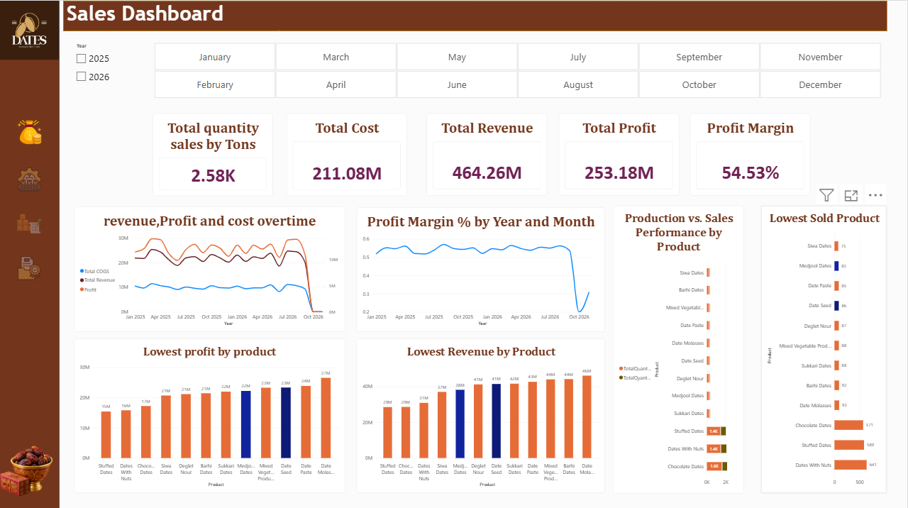
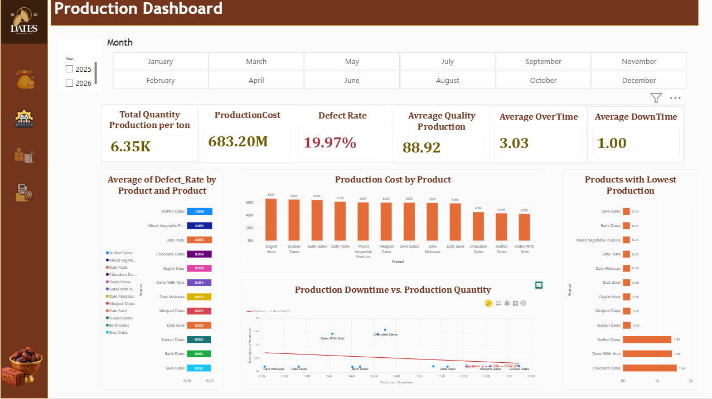
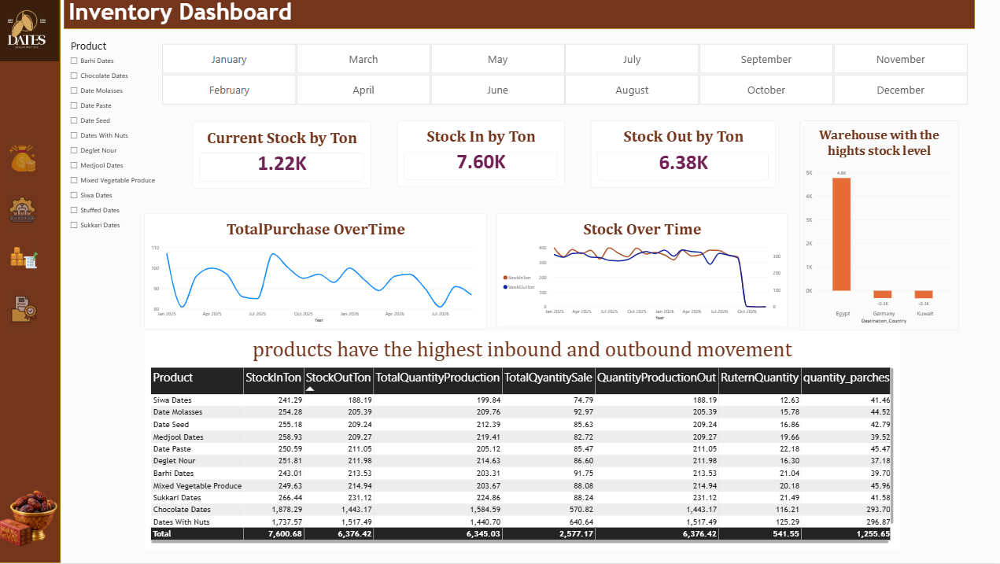
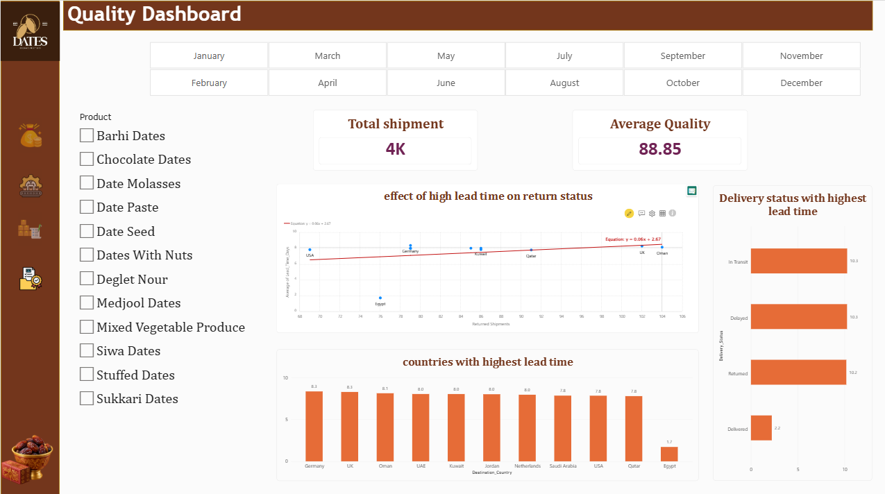
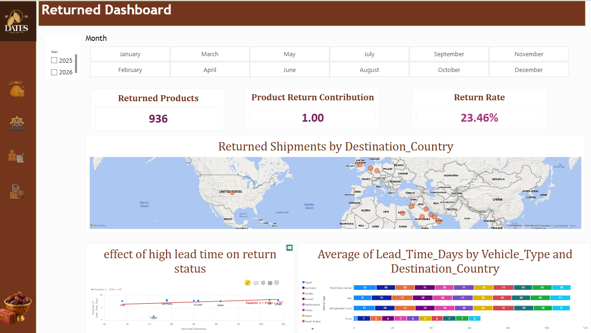

# Al Tahhan Golden Dates: Sales & Supply Chain Dashboard

A Power BI dashboard for a dates-processing company, covering sales, production, inventory, quality and returns in one model.

**Tools:** Power BI, DAX, Power Query

## Key Results

| KPI | Value |
|---|---|
| Sales revenue | EGP 464.3M |
| Gross profit | EGP 253.2M |
| Profit margin | 54.5% |
| Margin (Jan-Sep 2025 vs 2026) | 54.3% to 55.0% |
| Profit growth (Jan-Sep YoY) | +2.0% |
| Shipment return rate | 23.5% (936 of 3,989) |
| Production inspection failure rate | 20.0% |
| Current stock | 1,224 tons |

## Dashboard Preview

### Sales
Revenue, cost, profit and margin over time, plus lowest-selling and lowest-profit products.



### Production
Production volume and cost, defect rate, average quality, overtime and downtime by product.



### Inventory
Stock in, stock out, current stock, purchases over time and movement by product.



### Quality
Shipment quality and the effect of lead time on returns, by country and delivery status.



### Returns
Return rate, returned shipments by destination country and lead time by vehicle type.



## Dataset

- 30K+ transactions from Jan 2025 to Sep 2026 (21 months)
- 11 products and 11 destination countries
- 8 transaction types: Production, Sale, Shipment, Purchase, Transfer, Inspection, Maintenance, Non-Inventory

## Data Model

Star schema with one fact table and seven dimensions.

- **Fact:** `FactTransaction`
- **Dimensions:** `DateDim`, `productDim`, `shipDim`, `PaymentDim`, `DimFactory`, `EmpDim`, `BatchDim`

## Data Preparation (Power Query)

- Trimmed text and standardized capitalization
- Handled missing values and removed rows with errors
- Standardized units (boxes to kg to tons)
- Built dimension tables with surrogate keys and merged them into the fact table

## Main DAX Measures

`Total Revenue`, `Total COGS`, `Profit`, `Profit Margin %`, `Return_rate`, `DefectRate`, `CurrentStock`, `AVGQuality`, `AVGDowntown`, `AVGOvertTime`

## Insights

- Margin improved year over year while revenue stayed almost flat (+0.7%), so growth came from profitability.
- Return rate is highest in the UK (27.3%), Oman (26.9%) and Saudi Arabia (26.4%), and lowest in the USA (19.8%).
- Shipments that were delayed, in transit or returned average about 10 days of lead time, compared with 2.2 days for delivered shipments.
- Chocolate Dates (60%) and Medjool (58%) have the highest margins, and Barhi (49%) the lowest.
- Production (6,345 tons) is far above sales (2,577 tons), which points to an inventory build-up worth reviewing.

## Repository Structure

```
.
├── AltahanDashboard.pbix
├── data/
├── images/
│   ├── AlthanSales.png
│   ├── AlthanProduction.png
│   ├── AlthanInventory.png
│   ├── AlthanQuality.png
│   └── AlthanReturned.png
└── README.md
```
