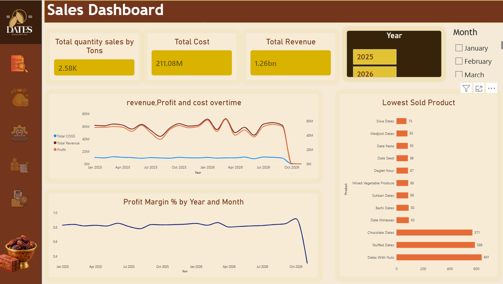

# althanDashboard
# Altahan Dashboard: Siwa Dates Business Analytics

A multi-page Power BI dashboard that tracks the full business chain of a dates producer (Siwa Dates): **sales, production, inventory, quality/logistics, returns, and what-if scenario planning**.

> **Tool:** Microsoft Power BI Desktop  |  **File:** `AltahanDashboard.pbix`  |  **Canvas:** 1920 × 1080

---

## Screenshots

<!-- Add screenshots to a /screenshots folder and update the paths below -->
| Sales Overview | Production |
|---|---|
|  |  |

| Inventory | Returned |
|---|---|
|  |  |

---

## Business Goal

Show where profit is made and lost between production and the customer, so management can:

- Identify the best and worst performing products by revenue, profit and quantity.
- Match production to sales and keep stock at the right level.
- Reduce downtime, overtime and defects in production.
- Understand how delivery lead time affects returns.
- Test how changes in sales volume affect revenue, cost, profit and margin.

---

## Dashboard Pages

| # | Page | What it shows |
|---|------|---------------|
| 1 | **Sales Overview** | Quantity sold (tons), total cost, total revenue, revenue/profit/cost trend, profit margin trend, lowest-selling products |
| 2 | **Sales** | Cost, revenue, profit and margin KPIs; lowest revenue and profit by product; production vs. sales by product |
| 3 | **Production** | Average downtime, overtime and quality; defect rate; production cost by product; downtime vs. production quantity |
| 4 | **Inventory** | Current stock, stock in/out, stock over time, total purchases over time, product movement table, stock by country |
| 5 | **Quality** | Total shipments, average quality, lead time by country and delivery status, lead time vs. returns |
| 6 | **Returned** | Returned shipments, return rate, product return contribution, return map, lead time by vehicle type |
| 7 | **What-if Analysis** | Sales change % parameter driving updated revenue, cost, profit and profit margin against a target margin |

Each page has Year and Month slicers, and pages 1 to 6 share a sidebar for navigation.

---

## Data Model

Star-schema style model with one central fact table and supporting dimensions.

| Table | Role |
|-------|------|
| `FactTransaction` | Central fact table (transactions, lead time, defect rate, etc.) |
| `DateDim` | Date dimension (Year and Month slicers) |
| `productDim` | Product dimension |
| `shipDim` | Shipping: destination country, delivery status, vehicle type |
| `BatchDim` | Production batches (includes target profit margin) |
| `DimFactory` | Factory dimension |
| `EmpDim` | Employee dimension |
| `PaymentDim` | Payment dimension |
| `MyMeasures` | Central table holding the DAX measures |
| `Siwa Dates Sales Change %` | What-if parameter table for scenario analysis |

### Key measures (in `MyMeasures`)

- **Financial:** Total Revenue, Total COGS, Profit, Profit Margin %
- **Sales and production:** Total Quantity Sale, Total Quantity Production, Production Cost
- **Operations:** Average Downtime, Average Overtime, Defect Rate, Average Quality, Production Downtime
- **Inventory:** Stock In (tons), Stock Out (tons), Current Stock, Total Purchase
- **Logistics and returns:** Total Shipments, Returned Shipments, Return Rate, Product Return Contribution

---

## Requirements

- **Power BI Desktop** (latest version recommended). The file uses the newer PBIR report format, so older versions may not open it.
- Two custom visuals are embedded in the file and load automatically:
  - **Performance Bubble Chart**
  - **Chip Slicer Pro**

## How to Use

1. Clone or download this repository.
2. Open `AltahanDashboard.pbix` in Power BI Desktop.
3. Use the sidebar icons to move between pages, and the Year and Month slicers to filter.
4. On the **What-if Analysis** page, move the *Sales Change %* slicer to see the updated revenue, cost, profit and margin.

> **Note:** If the data is stored inside the file, no refresh is needed. If you connect to a different data source, update it under **Home > Transform data > Data source settings**.

---

## Repository Structure

```
.
├── AltahanDashboard.pbix     # Power BI report and data model
├── README.md                 # Project documentation
└── screenshots/              # Dashboard images used in this README
```

---

## Key Insights to Look For

The dashboard is designed to answer questions such as:

- Which products have the lowest sales, revenue, profit or production?
- Where does production exceed sales (overproduction)?
- Which products or lines have the most downtime, overtime or defects?
- Which countries have the longest lead times, and do they have higher returns?
- What happens to profit if sales volume rises or falls by a given percentage?

---

## Known Limitations and Roadmap

- [ ] Add the Returned and What-if pages to the sidebar navigation
- [ ] Fix naming typos in measures and page names (for example `Invernory`, `ProductioCost`, `AVGDowntown`)
- [ ] Add period comparisons (YoY, MoM) and targets to KPI cards
- [ ] Add factory, employee and payment analysis using the existing dimension tables
- [ ] Extend the what-if page with price and cost scenarios
- [ ] Replace the Performance Bubble Chart with a native visual to reduce file size
- [ ] Add alt text for accessibility

---

## Author

**Fatma Magdy**

## License

Add a license of your choice (for example MIT) or state that the project is for portfolio use only.

> If the data comes from a real company, make sure it is anonymized or that you have permission to publish it before uploading.
